# Installing EmComm Tools

The EmComm Tools (ETC) ISO is Debian 12 with EmComm Tools installed, built
with [ISO-BUILD-PLAN.md](../ISO-BUILD-PLAN.md). You can run it from a USB
stick without installing anything (a "live" system, which starts fresh each
time), and install it to a computer's disk when you're ready. No internet is
needed to boot, install or run it.

You need:

- The ETC ISO file.
- A USB stick of 16 GB or more.
- A 64-bit computer with 8 GB of RAM. For installing: a 128 GB SSD (256 GB
  recommended). The installer erases the disk you choose.

## 1. Make a Ventoy USB stick

[Ventoy](https://www.ventoy.net) turns a USB stick into a boot menu for ISO
files: you copy the ISO onto the stick as a normal file, and the rest of the
stick is ordinary storage for your own files. ETC includes Ventoy 1.1.10 in
`/opt/ventoy`.

### Install Ventoy on the stick

This erases the USB stick.

- **Windows:** download Ventoy from ventoy.net, run `Ventoy2Disk.exe`, choose
  the stick and click **Install**.
- **Linux:** download Ventoy from ventoy.net (or use `/opt/ventoy` on an ETC
  system), find the stick's device name with `lsblk` (for example `/dev/sdb`),
  then:

  ```bash
  sudo /opt/ventoy/Ventoy2Disk.sh -i /dev/sdX
  ```

The stick now has a large partition named **Ventoy** (exFAT), which Windows,
macOS and Linux can all open.

### Copy ETC onto the stick

Copy the ISO file onto the **Ventoy** partition. You can rename it, for example
to `emcomm-tools.iso`.

### Secure Boot

Computers with Secure Boot on need Ventoy's one-time Secure Boot setup the
first time they boot the stick: see Ventoy's Secure Boot page on ventoy.net.
The ETC ISO itself supports Secure Boot.

## 2. Boot the stick

Plug in the stick, start the computer and open its boot menu (often **F12**,
**F11**, **F10** or **Esc** while it starts; it varies by maker). Choose the USB
stick.

Ventoy lists the ISO files on the stick. Choose the ETC ISO:

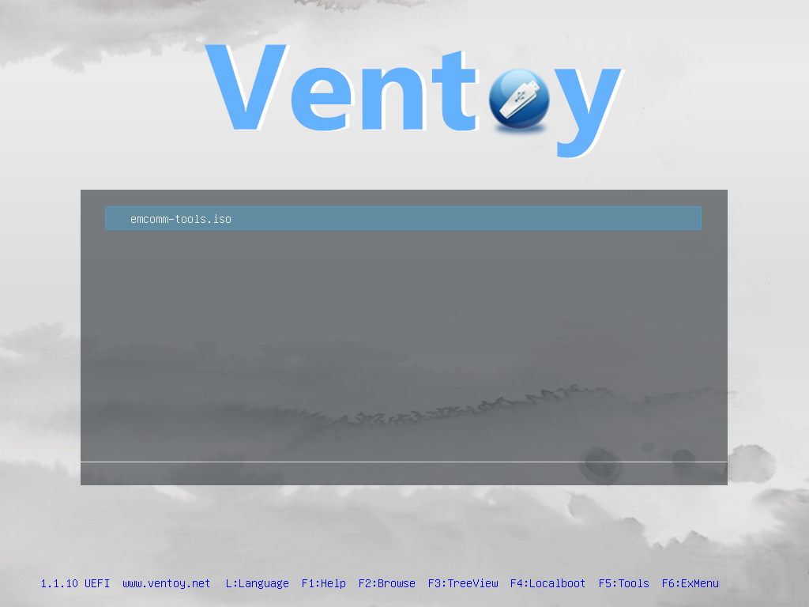

Choose **Boot in normal mode**:

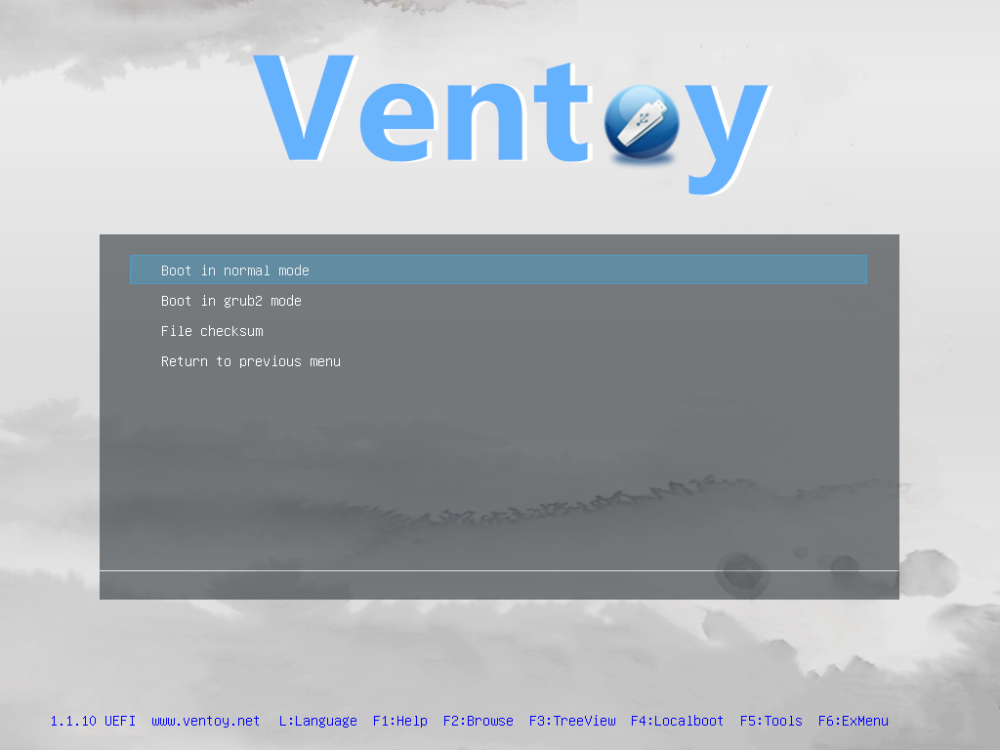

The ETC boot menu appears. Press **Enter** for **Try or Install EmComm Tools**:

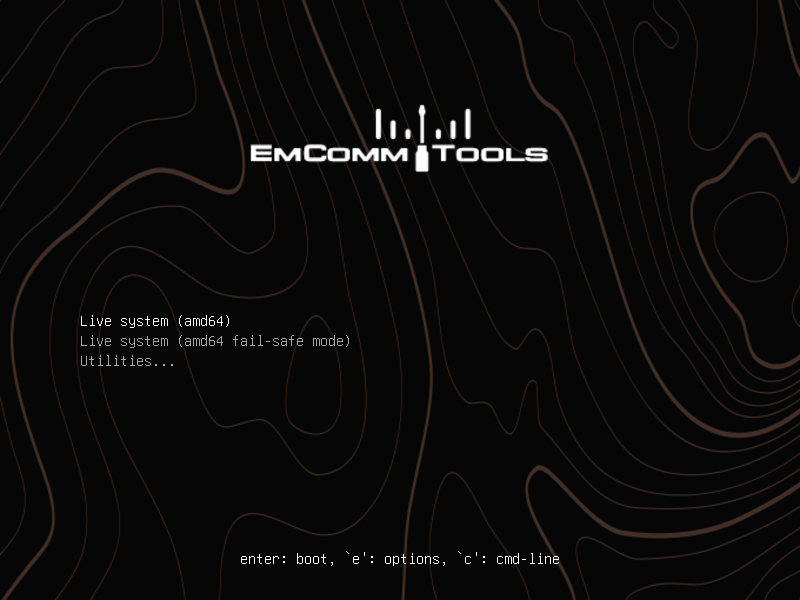

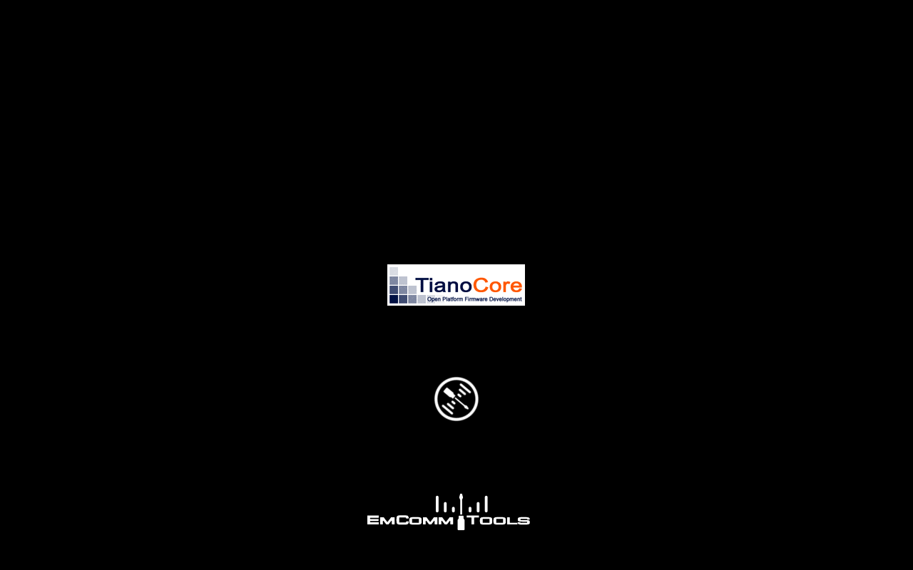

## 3. The live system

ETC starts and opens the installer. To try EmComm Tools first, close it; to
install later, double-click **Install EmComm Tools** on the desktop. Your
callsign, grid square and Winlink password, if saved in **EmComm Tools User
Configuration**, carry into the install.

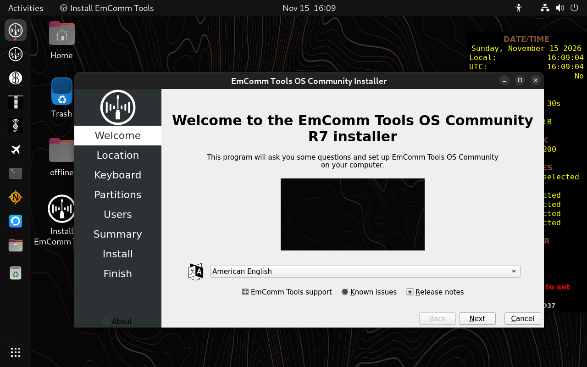

## 4. Install

The installer erases the disk you choose. Back up anything on it first.

**Welcome:** choose your language and click **Next**.

**Location:** choose your region and time zone.

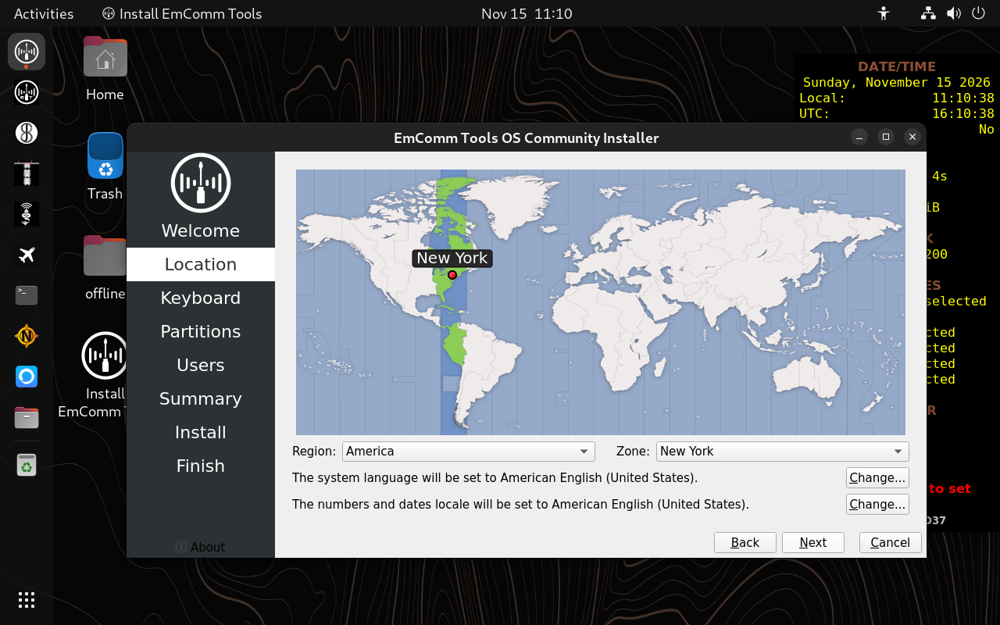

**Keyboard:** choose your keyboard layout.

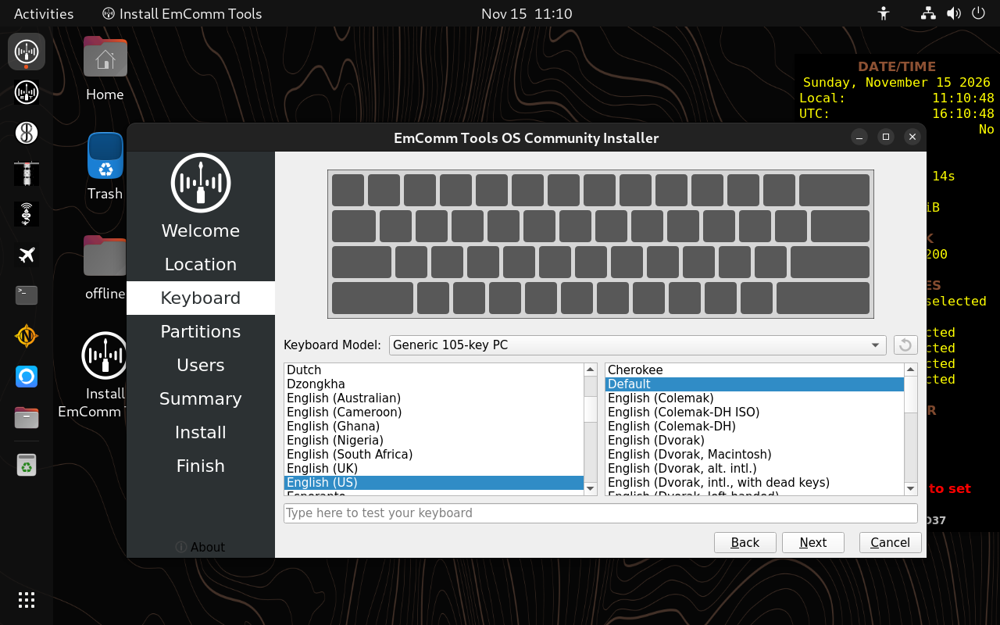

**Partitions:** choose the disk and **Erase disk**. To encrypt the whole disk,
tick **Encrypt system** and set a passphrase; it's asked for at every start.

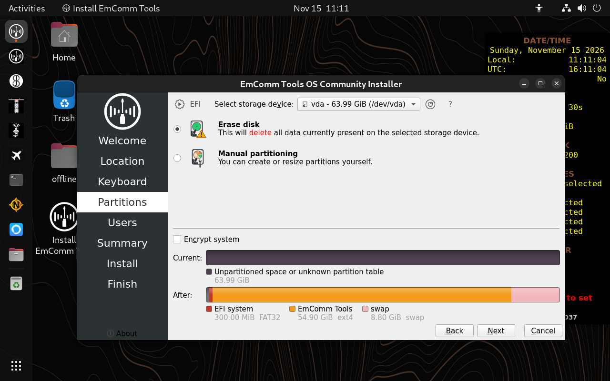

**Users:** enter your name, login name, computer name and password.

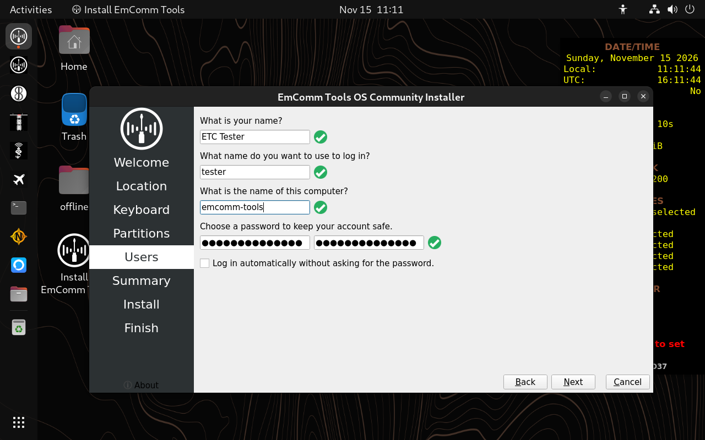

**Summary:** check the plan and click **Install**.

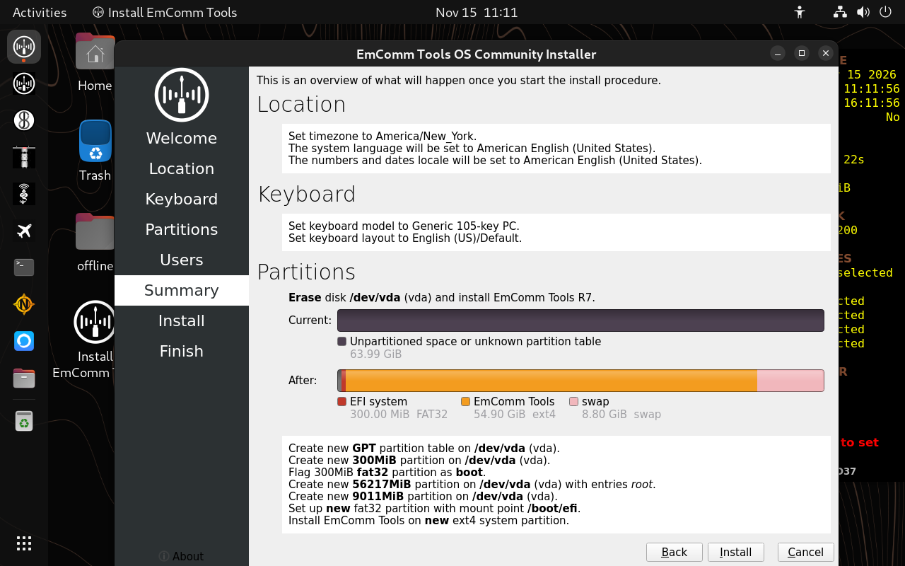

The installation takes about 15 minutes.

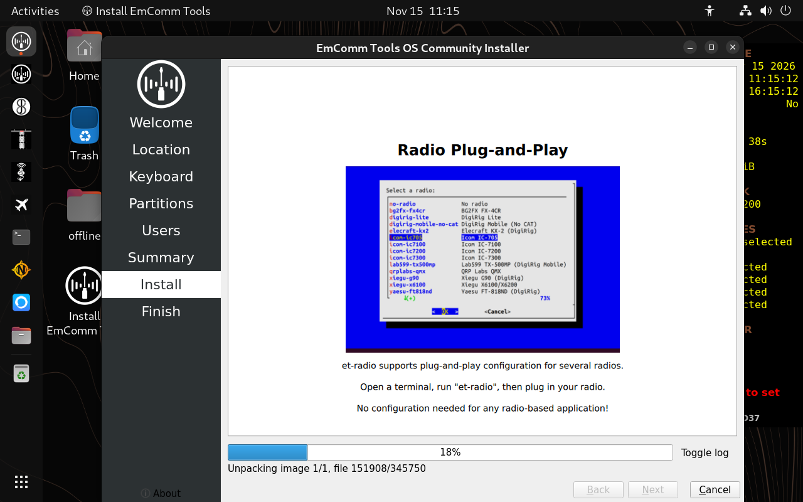

When it's done, click **Done** to restart, and remove the USB stick when the
computer restarts.

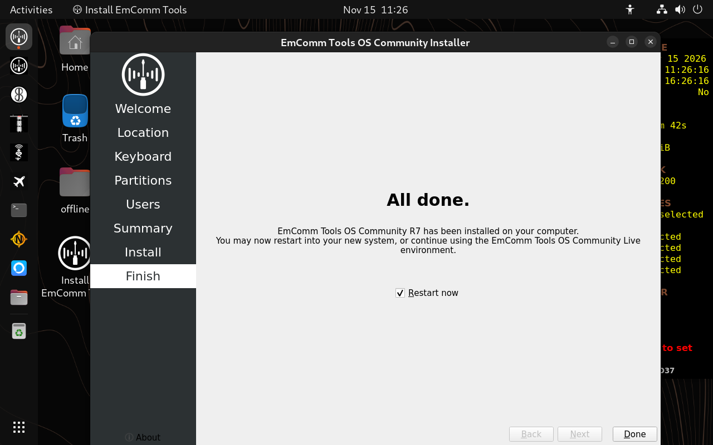

## 5. First start

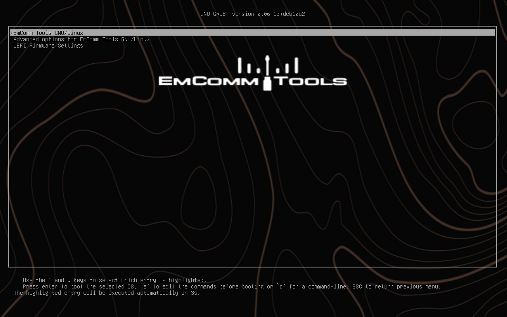

Log in. If you didn't save your callsign and grid square in the live system,
**EmComm Tools User Configuration** opens; enter them there:

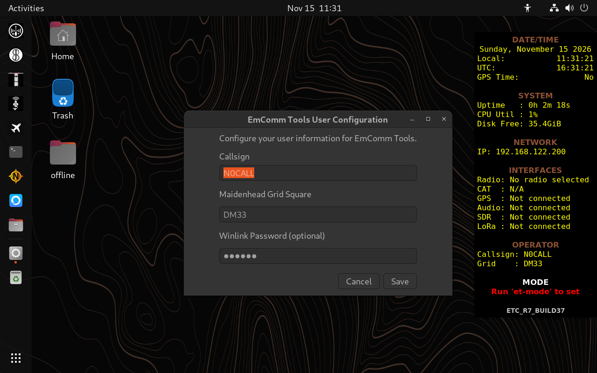

## 6. After installing

Maps, Wikipedia (`.zim`) files and xara are those chosen when the ISO was
built. VARA is added after install: see
`/opt/emcomm-tools-os-community/scripts/wine.txt`.
